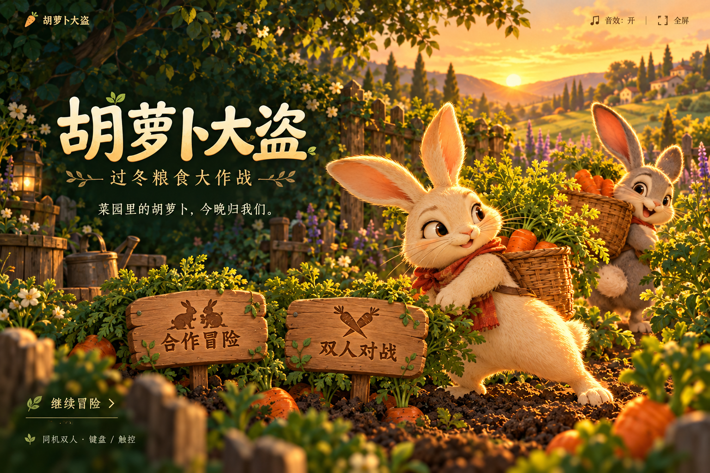

# 胡萝卜大盗 · Carrot Heist

两只兔子，五片菜园，把收获带回家。纯 HTML、CSS 和 JavaScript 的同机双人游戏，无需后端或账号。



## 玩法

- **合作冒险**：共同收集胡萝卜并存回兔洞，完成五关收获目标；后续关卡加入投刀、强盗、空投工具和炸弹。
- **双人对战**：90 秒内各自采集、存菜，从上方踩中对方可抢夺收获。
- 奶油兔：A / D 移动，W 跳跃，S 丢菜。
- 灰灰兔：← / → 移动，↑ 跳跃，↓ 丢菜。
- P / Esc 暂停。触屏设备提供操作按钮，建议横屏游玩。

进度和最佳纪录保存在当前浏览器 localStorage 中，更换设备或域名不会自动同步。

## 本地运行

```sh
python3 -m http.server 8765
```

打开 http://localhost:8765 。无 npm 运行依赖。

## 检查与构建

需要 Node.js 22 或更高版本：

```sh
npm test
npm run build
```

静态站点输出到 `public/`。Vercel 导入仓库后会使用 `vercel.json` 中的构建配置。

需要单文件离线版时执行 `python3 scripts/bundle.py`，结果保存在 `output/`。

## 文件说明

- `game.js`：物理、角色、收菜与对战。
- `campaign.js`：五关配置、关卡机制和存档。
- `presentation.*` / `campaign-ui.js`：首页、入场、提示和结算界面。
- `assets/`：插画、角色与场景；素材说明见 `assets/README.md`。
- `tests/campaign.test.cjs`：关卡、移动、空投及界面状态检查。

## 素材与许可证

代码采用 MIT 许可证。项目中的游戏插画由 OpenAI ImageGen 生成，随项目按 MIT 条款提供；生成素材说明见 `assets/README.md`。首页采用整幅插画与可访问的 HTML 按钮点击区域，交互逻辑独立于图像。
